# Modelo de Domínio — RemindMe

Conceitos do negócio, suas responsabilidades, relações e regras. O modelo descreve o domínio: não descreve banco de dados, telas nem arquitetura.

Este texto é a fonte. O diagrama é uma vista dele e deve ser regerado quando o texto mudar. O vocabulário está no [glossário](glossario.md).

## 1. Classes e responsabilidades

| Classe | Responsabilidade | Regras que guarda |
|---|---|---|
| `Perfil` | Define o papel de acesso de um usuário. | RB-03 |
| `AlcadaDesconto` | Limita o desconto que um perfil concede sem aprovação. | RB-15 |
| `Usuario` | Identifica quem opera o sistema e responde por cada operação. | RB-01 |
| `Cliente` | Identifica quem recebe orçamentos e deve títulos. Não é usuário do sistema (OPEN-57). | — |
| `Orcamento` | Conduz a proposta comercial do rascunho à conversão em título. Calcula seus valores e controla seu estado. | RB-05, RB-15, RB-24 |
| `ItemOrcamento` | Descreve um produto ou serviço orçado, com quantidade e valor. | RB-24 |
| `AprovacaoDesconto` | Registra a decisão do Dono ou do Administrador (OPEN-53) sobre um desconto acima da alçada. | RB-15 |
| `Titulo` | Representa um valor a receber. Controla saldo, vencimento e estado. É a classe central do modelo. | RB-10, RB-11, RB-21, RB-22, RB-23 |
| `Pagamento` | Registra um valor recebido para um título ou pago para uma conta a pagar. Pode ser estornado. | RB-02, RB-23, RB-32 |
| `Renegociacao` | Registra a mudança de condições de um título, preservando as condições originais. | RB-20, RB-28 |
| `ReguaCobranca` | Agrupa as etapas de cobrança aplicadas aos títulos. | RB-10 |
| `EtapaCobranca` | Define quando e como cobrar: prazo em dias em relação ao vencimento, mensagem e ação. | — |
| `TentativaCobranca` | Registra a execução de uma etapa para um título, com data e resultado. | RB-01 |
| `Empresa` | Identifica a empresa que usa o sistema. Há um único registro, mantido pelo Dono (OPEN-54). | — |
| `Fornecedor` | Identifica de quem a empresa compra, com documento único. | — |
| `ContaPagar` | Representa um valor a pagar a um fornecedor. Controla saldo, vencimento e estado (Spec 018). | RB-31, RB-32, RB-33 |
| `Obrigacao` | Representa uma ocorrência de um compromisso fiscal, trabalhista ou contratual, com prazo e responsável. Controla seu estado, guarda o histórico e gera a próxima ocorrência da série (Spec 010). | RB-07, RB-13, RB-16, RB-29 |
| `Evidencia` | Comprova o cumprimento de uma obrigação: arquivo PDF, PNG ou JPG de até 5 MB, com descrição (OPEN-68). | RB-29 |
| `LancamentoFinanceiro` | Registra uma receita ou despesa para a apuração do resultado. | RB-06, RB-12 |
| `CategoriaFinanceira` | Representa uma conta do plano de contas, de receita ou de despesa. | RB-08 |
| `SugestaoClassificacao` | Guarda a categoria sugerida pela IA, a confiança e se foi aceita. | RB-08, RB-09, RB-14 |
| `RegistroAuditoria` | Registra uma operação de forma imutável. | RB-01, RB-30 |

### O que ficou fora do modelo

- **Canal de notificação, serviço de IA e agendador** são atores e mecanismos, e não conceitos do negócio. Aparecem nos casos de uso e na arquitetura.
- **Fila de revisão** não é classe. É o conjunto dos lançamentos no estado Pendente de Classificação.
- **Painel, tela, relatório e arquivo CSV** são termos técnicos ou de interface.

## 2. Relações e multiplicidades

1. Um `Perfil` é atribuído a zero ou mais `Usuario`. Cada `Usuario` tem exatamente um `Perfil`.
2. Um `Perfil` tem zero ou uma `AlcadaDesconto`. Perfil sem alçada não concede desconto; o perfil Dono não tem limite (RB-15).
3. Um `Usuario` elabora zero ou mais `Orcamento`. Cada `Orcamento` é elaborado por exatamente um `Usuario`.
4. Um `Cliente` recebe zero ou mais `Orcamento`. Cada `Orcamento` é de exatamente um `Cliente`.
5. Um `Orcamento` contém zero ou mais `ItemOrcamento`, por composição: o item não existe fora do orçamento. Um orçamento em Rascunho pode estar sem itens, mas só é enviado com ao menos um (RB-24).
6. Um `Orcamento` guarda zero ou mais `AprovacaoDesconto`, por composição: uma para cada desconto acima da alçada decidido, aprovado ou rejeitado, e o histórico fica no orçamento. Cada `AprovacaoDesconto` é decidida por exatamente um `Usuario`, de perfil Dono ou Administrador (OPEN-53).
7. Um `Orcamento` origina zero ou um `Titulo`. Um `Titulo` vem de zero ou um `Orcamento`: título cadastrado manualmente não tem orçamento (RF-20).
8. Um `Cliente` deve zero ou mais `Titulo`. Cada `Titulo` é devido por exatamente um `Cliente`.
9. Um `Titulo` recebe zero ou mais `Pagamento`, por composição.
10. Um `Titulo` sofre zero ou mais `Renegociacao`. Cada `Renegociacao` é de exatamente um `Titulo`.
11. Uma `ReguaCobranca` é composta de uma ou mais `EtapaCobranca`. Régua sem etapa é inválida.
12. Um `Titulo` tem zero ou mais `TentativaCobranca`. Cada `TentativaCobranca` é de exatamente um `Titulo` e executa exatamente uma `EtapaCobranca`.
13. Um `Usuario` responde por zero ou mais `Obrigacao`. Cada `Obrigacao` tem exatamente um responsável. Cada ocorrência aponta para zero ou uma próxima ocorrência da mesma série (`proximaOcorrencia`, RF-42).
14. Uma `Obrigacao` é comprovada por zero ou mais `Evidencia`, por composição. Cada `Evidencia` é anexada por exatamente um `Usuario`.
15. Um `Pagamento` gera um ou mais `LancamentoFinanceiro`: um no registro e outro, de sinal contrário, se for estornado. Um `LancamentoFinanceiro` vem de zero ou um `Pagamento`.
16. Uma `CategoriaFinanceira` classifica zero ou mais `LancamentoFinanceiro`. Um `LancamentoFinanceiro` tem zero ou uma `CategoriaFinanceira`; sem categoria, está Pendente de Classificação (RB-12).
17. Um `LancamentoFinanceiro` recebe zero ou mais `SugestaoClassificacao`. Cada `SugestaoClassificacao` aponta exatamente uma `CategoriaFinanceira`.
18. Um `Usuario` é responsável por zero ou mais `RegistroAuditoria`. Um `RegistroAuditoria` tem zero ou um `Usuario`: operações automáticas do sistema não têm usuário.
19. Um `Fornecedor` recebe zero ou mais `ContaPagar`. Cada `ContaPagar` é de exatamente um `Fornecedor`.
20. Uma `ContaPagar` recebe zero ou mais `Pagamento`, por composição, como o `Titulo`. Cada `Pagamento` é de um título ou de uma conta a pagar, nunca dos dois: no diagrama, as duas composições levam a restrição `{xor}`, e o lado do todo tem multiplicidade `0..1` em cada uma. O código usa a mesma classe nos dois casos.
21. A `Empresa` é um registro único, sem associação com as demais classes: identifica quem usa o sistema.

## 3. Atributos derivados e operações que representam regra

| Classe | Operação | Regra |
|---|---|---|
| `Orcamento` | `valorBruto()` | Soma de quantidade × valor unitário dos itens. |
| `Orcamento` | `valorLiquido()` | Valor bruto menos o desconto percentual. |
| `Orcamento` | `enviar()` | Exige ao menos um item (RB-24), desconto dentro da alçada ou aprovado (RB-15), prazo para pagamento (OPEN-61) e valor líquido maior que zero (Spec 005). |
| `Orcamento` | `registrarDecisao()` | Só aceita decisão em orçamento Enviado, com data entre o envio e hoje (Spec 005). |
| `Orcamento` | `converter()` | Só orçamento Aprovado vira título (RF-12); passa a Convertido, ligado ao título, na mesma operação da aprovação (RB-05). |
| `Titulo` | `gerarDeOrcamento()` | Copia do orçamento Aprovado o cliente, o valor líquido e a condição; vencimento = data da decisão + prazo para pagamento (RF-19, OPEN-61). |
| `Titulo` | `saldo()` | Valor menos a soma dos pagamentos não estornados. |
| `Titulo` | `registrarPagamento()` | Recusa valor menor ou igual a zero ou maior que o saldo (RB-23). Saldo zero baixa o título (RB-22). |
| `Titulo` | `marcarVencido()` | Só se aplica a título Aberto com saldo maior que zero e vencimento passado (RB-21). |
| `Titulo` | `estornarPagamento()` | Anula um pagamento, exige motivo e restaura o saldo; Baixado volta a Aberto ou Vencido conforme o vencimento (RF-30). Quem pode estornar (RB-02) é verificado na aplicação, antes do domínio (DT-06). |
| `ContaPagar` | `saldo()` | Valor menos a soma dos pagamentos não estornados. |
| `ContaPagar` | `registrarPagamento()` | Recusa valor menor ou igual a zero ou maior que o saldo (RB-32). Saldo zero torna a conta Paga (RB-31). |
| `ContaPagar` | `marcarVencida()` | Só se aplica a conta Aberta com vencimento passado (RF-90). |
| `ContaPagar` | `estornarPagamento()` | Exige motivo; Paga volta a Aberta ou Vencida conforme o vencimento (RF-92). Quem pode estornar (RB-33) é verificado na aplicação (DT-06). |
| `ContaPagar` | `cancelar()` | Exige motivo; só Aberta ou Vencida (RF-93, RB-31). |
| `Obrigacao` | `registrarCumprimento()` | Exige evidência quando a obrigação a exige (RB-29); sem ela, Pendente passa a Aguardando Evidência e Atrasada continua Atrasada até o anexo. Qualquer usuário autorizado registra (OPEN-69). |
| `Obrigacao` | `anexarEvidencia()` | Com o cumprimento já registrado, leva a Cumprida (RB-29). |
| `Obrigacao` | `alterarPrazo()` | Só em Pendente ou Aguardando Evidência, e nunca para antes de hoje; não muda o prazo de referência (RF-41, OPEN-70). |
| `Obrigacao` | `alterarResponsavel()` | Usuário ativo, Dono ou Operador Financeiro; não em Cumprida (RF-41, OPEN-69). |
| `Obrigacao` | `marcarAtrasada()` | Pendente ou Aguardando Evidência com prazo anterior a hoje (RF-48). |
| `Obrigacao` | `gerarProximaOcorrencia()` | Prazo de referência avançado pela periodicidade, no dia-base ou no último dia do mês (RF-42, OPEN-70). |

## 4. Ciclos de vida

Orçamento, título e obrigação têm estados explícitos. Os diagramas e as tabelas de transição estão em [estados](uml/estados.md).

## 5. Diagrama de classes conceitual

Convenções do diagrama (v6):

- Atributos privados (`-`) e operações públicas (`+`), com o tipo do domínio: `String`, `Integer`, `Decimal` (valores monetários e percentuais, nunca ponto flutuante), `Boolean`, `Date` e `DateTime`. `[0..1]` marca o atributo opcional. Operação sublinhada é de classe (`gerarDeOrcamento()` cria o título).
- Os estados e as classificações fechadas são `«enumeration»`.
- Identificadores técnicos (`id`) e referências que repetem uma associação ficam fora, porque o modelo é do domínio e não do banco.
- Classes `«planejado»`, tracejadas e em cinza, fazem parte do modelo aprovado, mas ainda não estão implementadas: régua de cobrança (Specs 007 e 008), renegociação (Spec 009) e lançamentos, categorias e sugestões da IA (Specs 011 e 012). As demais estão implementadas em `src/remindme/dominio` e verificadas pelas specs da [situação do projeto](../README.md#situação-do-projeto).

Fonte: [`uml/dominio-v2.mmd`](uml/dominio-v2.mmd). Imagem exportada: [`uml/dominio-v2.png`](uml/dominio-v2.png).

```mermaid
classDiagram
    direction LR

    %% ===== Acesso =====
    class Perfil {
        -nome : String
    }
    class AlcadaDesconto {
        -percentualMaximo : Decimal [0..1]
    }
    class Usuario {
        -nome : String
        -email : String
        -ativo : Boolean
    }

    %% ===== Comercial =====
    class Cliente {
        -nome : String
        -documento : String
        -contato : String
    }
    class Orcamento {
        -criadoEm : Date
        -condicaoPagamento : String [0..1]
        -percentualDesconto : Decimal
        -prazoPagamentoDias : Integer [0..1]
        -enviadoEm : Date [0..1]
        -decididoEm : Date [0..1]
        -motivoRejeicao : String [0..1]
        -motivoCancelamento : String [0..1]
        -estado : EstadoOrcamento
        +valorBruto() Decimal
        +valorLiquido() Decimal
        +incluirItem(descricao, quantidade, valorUnitario)
        +informarDesconto(percentual, alcada) Boolean
        +decidirDesconto(aprovar, percentualAprovado) AprovacaoDesconto
        +marcarEnviado(data: Date)
        +registrarDecisao(aprovado: Boolean, data: Date, motivo)
        +converter(titulo: Titulo)
        +cancelar(motivo: String)
    }
    class ItemOrcamento {
        -descricao : String
        -quantidade : Decimal
        -valorUnitario : Decimal
        +total() Decimal
    }
    class AprovacaoDesconto {
        -aprovado : Boolean
        -percentualSolicitado : Decimal
        -percentualAprovado : Decimal [0..1]
        -data : Date
    }

    %% ===== Recebíveis =====
    class Titulo {
        -valor : Decimal
        -vencimento : Date
        -origem : String
        -condicaoPagamento : String [0..1]
        -estado : EstadoTitulo
        +gerarDeOrcamento(orcamento: Orcamento)$ Titulo
        +saldo() Decimal
        +registrarPagamento(valor: Decimal, data: Date) Pagamento
        +estornarPagamento(pagamento: Pagamento, motivo: String)
        +marcarVencido(hoje: Date) Boolean
        +cancelar(motivo: String)
    }
    class Pagamento {
        -valor : Decimal
        -data : Date
        -estornado : Boolean
        -motivoEstorno : String [0..1]
    }
    class Renegociacao {
        <<planejado>>
        -vencimentoAnterior : Date
        -novoVencimento : Date
        -valorPrometido : Decimal
        -situacao : String
        -data : Date
    }

    %% ===== Cobrança =====
    class ReguaCobranca {
        <<planejado>>
        -nome : String
    }
    class EtapaCobranca {
        <<planejado>>
        -prazoEmDias : Integer
        -mensagem : String
        -acao : String
    }
    class TentativaCobranca {
        <<planejado>>
        -data : DateTime
        -resultado : String
    }

    %% ===== Pagáveis =====
    class Fornecedor {
        -nome : String
        -documento : String
        -contato : String
    }
    class ContaPagar {
        -descricao : String
        -valor : Decimal
        -vencimento : Date
        -condicaoPagamento : String [0..1]
        -estado : EstadoContaPagar
        +saldo() Decimal
        +registrarPagamento(valor: Decimal, data: Date) Pagamento
        +estornarPagamento(pagamento: Pagamento, motivo: String)
        +marcarVencida(hoje: Date) Boolean
        +cancelar(motivo: String)
    }

    %% ===== Obrigações =====
    class Obrigacao {
        -nome : String
        -tipo : TipoObrigacao
        -periodicidade : Periodicidade
        -prazo : Date
        -prazoReferencia : Date
        -diaBase : Integer
        -serie : String
        -exigeEvidencia : Boolean
        -cumprimentoEm : Date [0..1]
        -proximaOcorrencia : Obrigacao [0..1]
        -estado : EstadoObrigacao
        +registrarCumprimento(data: Date, evidencia)
        +anexarEvidencia(evidencia: Evidencia)
        +alterarPrazo(prazo: Date, hoje: Date)
        +alterarResponsavel(responsavel: Usuario)
        +marcarAtrasada(hoje: Date) Boolean
        +gerarProximaOcorrencia(hoje: Date) Obrigacao
    }
    class Evidencia {
        -descricao : String
        -nomeArquivo : String
        -tipoArquivo : String
        -tamanho : Integer
        -anexadaEm : DateTime
    }

    %% ===== Resultado =====
    class LancamentoFinanceiro {
        <<planejado>>
        -descricao : String
        -valor : Decimal
        -tipo : String
        -data : Date
        -estado : String
    }
    class CategoriaFinanceira {
        <<planejado>>
        -nome : String
        -tipo : String
    }
    class SugestaoClassificacao {
        <<planejado>>
        -confianca : Decimal
        -aceita : Boolean
    }

    %% ===== Auditoria e empresa =====
    class RegistroAuditoria {
        -dataHora : DateTime
        -operacao : String
        -registroAfetado : String
        -campo : String [0..1]
        -valorAnterior : String [0..1]
        -valorNovo : String [0..1]
        -motivo : String [0..1]
        -automatica : Boolean
    }
    class Empresa {
        -razaoSocial : String
        -nomeFantasia : String [0..1]
        -cnpj : String
        -telefone : String [0..1]
        -email : String [0..1]
        -endereco : String [0..1]
    }

    %% ===== Enumerações =====
    class EstadoOrcamento {
        <<enumeration>>
        Rascunho
        PendenteDeAlcada
        Enviado
        Aprovado
        Rejeitado
        Convertido
        Cancelado
    }
    class EstadoTitulo {
        <<enumeration>>
        Aberto
        Vencido
        EmRenegociacao
        Baixado
        Cancelado
    }
    class EstadoContaPagar {
        <<enumeration>>
        Aberta
        Vencida
        Paga
        Cancelada
    }
    class EstadoObrigacao {
        <<enumeration>>
        Pendente
        AguardandoEvidencia
        Atrasada
        Cumprida
    }
    class TipoObrigacao {
        <<enumeration>>
        Fiscal
        Trabalhista
        Contratual
        Outra
    }
    class Periodicidade {
        <<enumeration>>
        Unica
        Mensal
        Trimestral
        Semestral
        Anual
    }

    %% ===== Associações =====
    Perfil "1" -- "0..*" Usuario : atribuído a
    Perfil "1" -- "0..1" AlcadaDesconto : limitado por
    Usuario "1" -- "0..*" Orcamento : elabora
    Cliente "1" -- "0..*" Orcamento : recebe
    Orcamento "1" *-- "0..*" ItemOrcamento : contém
    Orcamento "1" *-- "0..*" AprovacaoDesconto : decisões de desconto
    Usuario "1" -- "0..*" AprovacaoDesconto : decide
    Orcamento "0..1" -- "0..1" Titulo : origina
    Cliente "1" -- "0..*" Titulo : deve
    Titulo "0..1" *-- "0..*" Pagamento : recebe
    ContaPagar "0..1" *-- "0..*" Pagamento : recebe
    Fornecedor "1" -- "0..*" ContaPagar : recebe
    Titulo "1" -- "0..*" Renegociacao : sofre
    ReguaCobranca "1" *-- "1..*" EtapaCobranca : composta de
    Titulo "1" -- "0..*" TentativaCobranca : tem
    EtapaCobranca "1" -- "0..*" TentativaCobranca : executada em
    Usuario "1" -- "0..*" Obrigacao : responde por
    Obrigacao "1" *-- "0..*" Evidencia : comprovada por
    Usuario "1" -- "0..*" Evidencia : anexa
    Pagamento "0..1" -- "1..*" LancamentoFinanceiro : gera
    CategoriaFinanceira "0..1" -- "0..*" LancamentoFinanceiro : classifica
    LancamentoFinanceiro "1" -- "0..*" SugestaoClassificacao : recebe
    CategoriaFinanceira "1" -- "0..*" SugestaoClassificacao : sugerida em
    Usuario "0..1" -- "0..*" RegistroAuditoria : responsável por

    note for Pagamento "{xor} cada Pagamento pertence a um Titulo ou a uma ContaPagar, nunca aos dois"
    note for Empresa "Registro único (OPEN-54), sem associação com as demais classes"
    note for EstadoTitulo "EmRenegociacao é planejado (Spec 009)"

    style Renegociacao fill:#f4f4f4,stroke:#8a8a8a,stroke-dasharray:6 4,color:#555
    style ReguaCobranca fill:#f4f4f4,stroke:#8a8a8a,stroke-dasharray:6 4,color:#555
    style EtapaCobranca fill:#f4f4f4,stroke:#8a8a8a,stroke-dasharray:6 4,color:#555
    style TentativaCobranca fill:#f4f4f4,stroke:#8a8a8a,stroke-dasharray:6 4,color:#555
    style LancamentoFinanceiro fill:#f4f4f4,stroke:#8a8a8a,stroke-dasharray:6 4,color:#555
    style CategoriaFinanceira fill:#f4f4f4,stroke:#8a8a8a,stroke-dasharray:6 4,color:#555
    style SugestaoClassificacao fill:#f4f4f4,stroke:#8a8a8a,stroke-dasharray:6 4,color:#555
```

## 6. Rastreabilidade requisito → classe

| Requisitos | Classes |
|---|---|
| RF-01 | `Cliente` |
| RF-02, RF-03, RF-65 a RF-67, RF-95 a RF-98 | `Usuario`, `Perfil` |
| RF-06 a RF-13 | `Orcamento`, `ItemOrcamento` |
| RF-14 a RF-18 | `AlcadaDesconto`, `AprovacaoDesconto`, `Orcamento` |
| RF-19 a RF-27, RF-30, RF-31, RF-68 | `Titulo`, `Pagamento` |
| RF-28, RF-29, RF-72 a RF-76 | `Renegociacao`, `Titulo` |
| RF-32 a RF-39, RF-70 | `ReguaCobranca`, `EtapaCobranca`, `TentativaCobranca` |
| RF-40 a RF-50, RF-77 | `Obrigacao`, `Evidencia` |
| RF-51, RF-52, RF-58, RF-59, RF-78 a RF-81, RF-86 | `LancamentoFinanceiro`, `CategoriaFinanceira`, `SugestaoClassificacao` |
| RF-53 a RF-57, RF-82 | `LancamentoFinanceiro`, `CategoriaFinanceira` |
| RF-04, RF-05, RF-61, RF-62, RF-64 | `RegistroAuditoria` |
| RF-87 | `Fornecedor` |
| RF-88 a RF-94 | `ContaPagar`, `Pagamento`, `Fornecedor` |
| OPEN-54 (dados da empresa) | `Empresa` |

## 7. Histórico

| Versão | Mudança |
|---|---|
| v1 | Primeira versão do diagrama. |
| v2 | Corrigida a multiplicidade entre `Usuario` e `Perfil`. Incluídos `Renegociacao`, `Evidencia`, `AprovacaoDesconto`, `SugestaoClassificacao` e `RegistroAuditoria`. `Titulo` passou a se ligar diretamente a `Cliente`. `HistoricoCobranca` virou `TentativaCobranca` e `SequenciaCobranca` virou `ReguaCobranca`. Removidos identificadores técnicos dos atributos. |
| v3 | Incluídos `Fornecedor` e `ContaPagar` (Spec 018) e `Empresa` (OPEN-54). `ContaPagar` também recebe `Pagamento`. O estorno passou a ser operação do `Titulo` (`estornarPagamento()`), e não do `Pagamento`, com a permissão verificada na aplicação (DV-07, DT-06). O arquivo do diagrama manteve o nome `dominio-v2.mmd`. |
| v4 | `Orcamento` ganha o prazo para pagamento, as datas de envio e de decisão do cliente, o motivo da rejeição e `converter()`; `Titulo` ganha `gerarDeOrcamento()` (Spec 005, OPEN-61). |
| v5 | `Obrigacao` ganha nome, prazo de referência, dia-base, série, data do cumprimento e as operações de alteração, anexo e atraso; `Evidencia` ganha nome, tipo e tamanho do arquivo (Spec 010, OPEN-68 a OPEN-71). |
| v6 | Revisão de 2026-11-25. Atributos com tipo e visibilidade, operações com parâmetros e retorno, e as enumerações de estado, de tipo de obrigação e de periodicidade. `Orcamento` → `AprovacaoDesconto` passa de `0..1` para composição `0..*`, como no código (uma decisão por pedido acima da alçada). As duas composições de `Pagamento` ganham a restrição `{xor}`. `Titulo` ganha a condição de pagamento; `Obrigacao`, a próxima ocorrência; `Usuario` anexa `Evidencia`. As classes ainda não implementadas levam o estereótipo `«planejado»`. |
